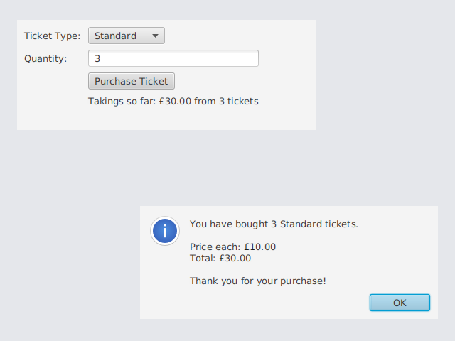

# Ticket Machine System

[](https://github.com/mcneillium/Ticket-Machine-System/actions/workflows/build.yml)

A small Java and JavaFX ticket machine, written to show the core ideas of
object-oriented programming: inheritance, polymorphism and encapsulation.

Case study: [paulmartinmcneill.com/projects/java-ticket-machine](https://paulmartinmcneill.com/projects/java-ticket-machine/)



## What it shows

- **Encapsulation:** `Ticket` keeps its type and price private behind getters
  and setters.
- **Inheritance:** `StandardTicket` (£10) and `StudentTicket` (£5) extend
  `Ticket` and set their own type and price.
- **Polymorphism:** the GUI, `TicketPrinter` and `TicketMachine` work with any
  `Ticket`. The machine keeps one list of the types it sells, and the window
  builds its drop-down from that list, so a new ticket type is one new class
  and one line.
- **Validation in the right place:** `Ticket` refuses a quantity below one;
  `TicketMachine.parseQuantity` turns what the user typed into a quantity or a
  clear message.

## Project layout

```
src/main/java/com/mycompany/ticket/machine/system/
  Ticket.java              base class (type, price)
  StandardTicket.java      £10 ticket
  StudentTicket.java       £5 ticket
  TicketPrinter.java       formats and prints a ticket
  TicketMachine.java       issues tickets, checks quantities, keeps takings
  TicketMachineGUI.java    JavaFX window: choose a ticket type and quantity
  TicketMachineSystem.java jar entry point
src/test/java/...          JUnit 6 tests
```

## Run it

Needs JDK 25 (the current long-term-support release) and Maven. JavaFX is downloaded by Maven.

```bash
git clone https://github.com/mcneillium/Ticket-Machine-System.git
cd Ticket-Machine-System
mvn javafx:run      # opens the GUI
mvn test            # runs the unit tests
```

The tests also run on every push (see the build badge above).

## Changes (November 2026)

- The quantity was ignored: buying three standard tickets reported £10. Each
  ticket now carries its quantity and total, and the window shows the
  machine's running takings.
- An empty or non-numeric quantity crashed the button handler. It now shows a
  message (an empty box means one ticket).
- The jar's entry point printed a message and exited; it now opens the window.
- Quantity moved from both subclasses into `Ticket`, which removed duplicated
  code. Tests went from 5 to 11.

### Second round (November 2026)

- Moved to **Java 25**, **JavaFX 25** and **JUnit 6**, the current long-term
  releases, and to the current GitHub Actions. Dependabot now proposes
  dependency updates once a month.
- The window used to pick a ticket class by comparing the drop-down's text
  with "Student". `TicketMachine` now holds the list of ticket types and
  builds the right one, so the window no longer names any subclass.
- Tests went from 11 to 13.

## Licence

MIT, see [LICENSE](LICENSE).
